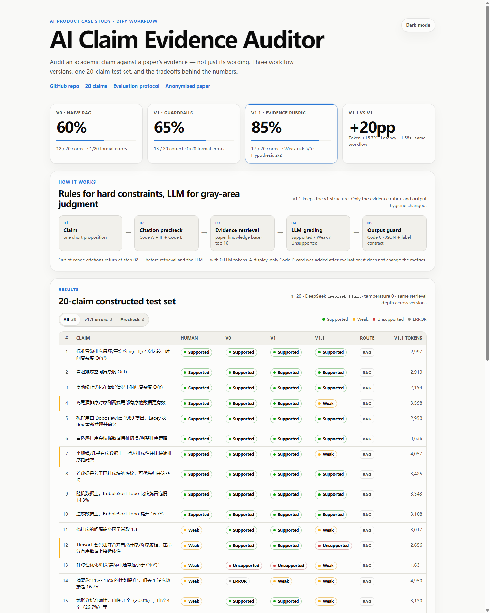
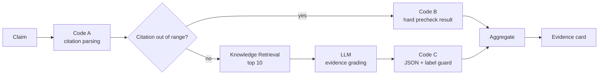

# AI Claim Evidence Auditor

**A small Dify workflow case study: audit an academic claim against a paper's evidence, not just its wording.**

[Live results page](https://xiaohuantang.github.io/claim-evidence-auditor/) · [20-claim dataset](data/claims.json) · [Evaluation protocol](docs/evaluation.md) · [Badcases](docs/badcases.md) · [Anonymized paper](paper/paper-anonymized.md)



---

## The problem

Academic writing and AI-generated text often contain claims without traceable evidence, including fabricated citation numbers. Most writing tools focus on grammar, plagiarism, or polishing. They do not answer a narrower question:

> Is this claim actually supported by the source, or does it only look like it is?

This project treats that as an **evidence audit** problem, not a writing problem.

## What it does

Input: one short claim.

Output: a structured evidence card with:

- `Supported` — the paper provides checkable evidence: a table, experiment, or citation that supports the claim.
- `Weak` — the paper has a related statement, but the evidence is indirect, qualitative, incomplete, inconsistent, or only in an attachment.
- `Unsupported` — no basis, a contradiction, a fake citation, a wrong attribution, or an author hypothesis presented as a conclusion.

The system also reports `fake_citation` and `hypothesis` flags, plus retrieval IDs for traceability.

## Workflow

The final version (v1.1) keeps the same workflow structure as v1 and changes only the evidence rubric and output hygiene.



> A display-only **Code D** card was added to the v1.1 Dify app after the 20-claim evaluation. It formats the result for the run panel and does not change labels, tokens, or metrics.

### Three versions, one controlled comparison

| Version | What changed | Why |
| --- | --- | --- |
| **v0** | Start → retrieval → LLM → End | Naive RAG baseline |
| **v1** | Code A citation parsing + IF precheck + Code C JSON guard | Move hard constraints into code; stop out-of-range citations before retrieval/LLM |
| **v1.1** | Same structure; evidence rubric + DeepSeek thinking-block cleanup + `max_tokens` 1024→2048 | Align the prompt with the annotation rubric without adding workflow nodes |

## Results

On a **20-claim constructed test set** (10 Supported / 5 Weak / 5 Unsupported, including 2 fabricated citations):

| Metric | v0 | v1 | v1.1 |
| --- | ---: | ---: | ---: |
| Three-level accuracy | 12/20 (60%) | 13/20 (65%) | **17/20 (85%)** |
| Format errors | 1/20 | 0/20 | 0/20 |
| Fake-citation detection | 2/2 | 2/2 | 2/2 |
| Weak-risk recall | 1/5 | 2/5 | **5/5** |
| Strict Weak hit | 0/5 | 1/5 | **4/5** |
| Hypothesis detection | 0/2 | 0/2 | **2/2** |
| Average tokens | 2,649 | 2,444 | 2,828 |
| Average latency | 2.73s | 2.70s | 4.28s |

**v1 vs v1.1:** accuracy +20pp, but token cost +15.7% and latency +1.58s. This is a deliberate accuracy-versus-cost tradeoff, not a free win.

**Important caveat:** v0 also caught both fabricated citations in this run. That was a **coincidence of this test set**, not evidence that v0 is reliable at fake-citation detection. v1's advantage is deterministic interception: the two out-of-range citations return before retrieval and the LLM, with **0 LLM tokens**.

## What the remaining errors taught me

The three remaining v1.1 errors are not retrieval failures. They are **rubric-boundary ambiguities**:

1. **Citation marker vs cited content** — #4 and #7 have `[6]` / `[9]` markers in the paper. The model treats the marker as insufficient because the retrieved snippet does not include the cited article's full text. The annotation guideline treats a marker plus a matching paper statement as sufficient.
2. **General algorithm fact vs claim about this paper's algorithm** — #12 (Timsort) is a general algorithm description with no citation; the model applies the "quantitative complexity claim needs measurement" rule too broadly and returns `Unsupported` instead of `Weak`.

I froze v1.1 at 17/20 instead of tuning the prompt against these 20 cases. The badcases are documented in [docs/badcases.md](docs/badcases.md).

## Product decisions

- **Rules for hard constraints, LLM for gray-area judgment.** Citation range checks and JSON contracts are deterministic; evidence strength is not.
- **Short-circuit before the model.** Two fabricated citations cost 0 LLM tokens under v1/v1.1.
- **Output contract matters.** LLM output is parsed, label-normalized, evidence-truncated, and marked `ERROR` when parsing fails.
- **Keep the comparison honest.** Same model, temperature 0, retrieval depth, and dataset across versions; change one dimension per iteration.
- **Do not optimize for a perfect score.** A 17/20 with explainable boundary errors is more useful than a 20/20 produced by fitting the test set.

## Repository layout

```text
.
├── README.md
├── data/claims.json          # 20 short claims + human labels
├── results/summary.json      # sanitized per-claim results (no evidence text)
├── docs/evaluation.md        # rubric, metrics, limitations
├── docs/badcases.md          # 3 boundary errors
├── prompts/v1.1-audit.md     # evidence-grading prompt
├── paper/                    # anonymized paper + original console-output figures
├── assets/results-page.png   # screenshot of the results page
├── site/                     # static results page (GitHub Pages)
└── .github/workflows/pages.yml
```

## Limitations

- `n=20` is a **constructed** test set for directional validation, not a benchmark.
- The Dify workflow and knowledge base run locally; this repo is the public case study and results page, not a hosted Dify instance.
- Retrieval uses Dify's economy keyword index, not a vector index. The next step would be a full-text reference index and a vector/hybrid retriever.
- The paper is published as an anonymized Markdown reconstruction in `paper/`; the original `.doc`, cover page, author/course metadata, and score/signature are not included.
- No API keys, Dify credentials, or private run logs are included.

## Status

**Frozen at v1.1 on 2026-11-16.** No v1.2 prompt-tuning against the evaluation set. Next step is to use the case study in an AI product portfolio, not to add more workflow nodes.
